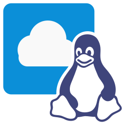

# OneDrive for Linux




**Unofficial Microsoft OneDrive client for Linux**: a desktop app that wraps OneDrive on the web with Linux integration.

✅ **Downloads with progress and notifications**  
✅ **`ms-word:`, `ms-excel:`, `ms-powerpoint:` links open in Office on the web**  
✅ **Work and personal accounts side by side**  
✅ **Light, dark or system theme**  

> [!NOTE]
> This is an independent project, not affiliated with or endorsed by Microsoft. Features are limited to what OneDrive on the web offers.

## Installation

### Fedora / RHEL (RPM)

Download the latest `.rpm` from [Releases](https://github.com/Bhavesh-Panchal/onedrive-for-linux/releases/latest), then:

```bash
sudo dnf install ./onedrive-for-linux-*.x86_64.rpm
```

Remove it again with `sudo dnf remove onedrive-for-linux`.

### Other formats

| Format | Status |
|---|---|
| RPM (Fedora, RHEL, openSUSE) | ✅ Available |
| DEB (Debian, Ubuntu) | 🔨 Build from source: `npm run package:deb` |
| AppImage | 🔨 Build from source: `npm run package:appimage` |
| Flatpak / Snap | 📋 Planned |

## Quick Start

1. **Install** using a method above.
2. **Launch** *OneDrive for Linux* from your application menu, or run `onedrive-for-linux` in a terminal.
3. **Sign in** with your work or personal Microsoft account.
4. **Configure** (optional) by creating `~/.config/onedrive-for-linux/config.json`. See [Configuration](#configuration).

## Features

- **Accounts:** work or school (`onedrive.cloud.microsoft`, which opens your organisation's OneDrive) and personal (`onedrive.live.com`); run both at once with [profiles](#multiple-accounts-profiles).
- **Office documents:** Word, Excel and PowerPoint open in Office on the web, in an app window or in your browser (`officeLinks.openIn`).
- **"Open in desktop app" links** (`ms-word:`, `ms-excel:`, `ms-powerpoint:` and other Office schemes) open the document in Office on the web, since Linux has no Office desktop app.
- **Downloads** with progress on the taskbar and a notification when done.
- **Uploads** by drag and drop or the file picker, as on the web.

> [!IMPORTANT]
> This is the OneDrive **web client** in a desktop window. It does **not** sync files to your disk. For sync, use
> [abraunegg/onedrive](https://github.com/abraunegg/onedrive) or [rclone](https://rclone.org/onedrive/).

### Tray and app menu

Right-click the tray icon, or use the *OneDrive for Linux* menu in the window:

Open · Return to My files · Refresh (F5) · Hide (Ctrl+H) · Debug › · Settings › · **Theme** › (Follow system / Light / Dark) · App Icon › · Zoom › · Notifications › · About · Help › · Quit (Clear Storage) · Quit

## Configuration

Settings are read from, in increasing priority:

1. `/etc/onedrive-for-linux/config.json`: system-wide, for administrators
2. `~/.config/onedrive-for-linux/config.json`: your settings
3. Command-line options, e.g. `onedrive-for-linux --window.startMinimized`

Example `~/.config/onedrive-for-linux/config.json`:

```json
{
  "account": "work",
  "officeLinks": {
    "openIn": "app"
  },
  "downloads": {
    "directory": "/home/you/Downloads/OneDrive",
    "openFolderWhenDone": true
  },
  "window": {
    "closeToTray": true
  }
}
```

*Settings → Show Active Configuration* in the app lists every option with its current value (sensitive values hidden).

| Option | Default | Description |
|---|---|---|
| `account` | – | Account type to open: one of the product's url keys (e.g. work, personal) |
| `url` | – | Start URL override, e.g. a sovereign-cloud tenant |
| `window.frame` | `true` | Use the native window frame |
| `window.menubar` | `"auto"` | Menu bar visibility (`auto`, `visible`, `hidden`) |
| `window.startMinimized` | `false` | Start hidden in the tray |
| `window.closeToTray` | `true` | Closing the window hides it to the tray |
| `tray.enabled` | `true` | Show a tray icon |
| `notifications.enabled` | `true` | Allow desktop notifications |
| `downloads.directory` | – | Download folder (default: XDG Downloads) |
| `downloads.ask` | `false` | Ask where to save each download |
| `downloads.openFolderWhenDone` | `false` | Show the file in the file manager when a download finishes |
| `spellcheck.languages` | `[]` | Spell-check languages, e.g. ["en-US", "de-DE"] |
| `appearance.customCSSFile` | – | Absolute path of a CSS file injected into the app |
| `appearance.fontAntialiasing` | `"grayscale"` | Text antialiasing: grayscale (like Firefox; thinner, no colour fringes) or system (fontconfig subpixel setting) (`grayscale`, `system`) |
| `network.proxyServer` | – | Chromium --proxy-server value |
| `network.authServerAllowlist` | – | Hosts allowed for Kerberos/NTLM (Chromium --auth-server-allowlist) |
| `network.allowInsecureHttp` | `false` | Treat http:// app hosts as trusted (testing only) |
| `network.userAgent` | – | User agent override |
| `performance.disableGpu` | `false` | Disable hardware acceleration |
| `logging.level` | `"info"` | Console log level (`error`, `warn`, `info`, `debug`) |
| `officeLinks.openIn` | `"app"` | Where Office documents open: an app window, or the system browser (`app`, `browser`) |

### Multiple accounts (profiles)

Each profile has its own sign-in, window and data, so work and personal accounts can run side by side:

```bash
onedrive-for-linux --profile=personal --account=personal
```

Per-profile settings go under `"profiles"` in `config.json`:

```json
{ "profiles": { "personal": { "account": "personal", "window": { "startMinimized": false } } } }
```

## Troubleshooting

| Problem | Try |
|---|---|
| Something also fails in a browser | Open https://onedrive.live.com in Firefox or Chrome. If it fails there too, it is a Microsoft issue; report it to Microsoft. |
| Text looks bolder than in Firefox | Default is grayscale text (`appearance.fontAntialiasing: "grayscale"`). Set `"system"` to follow your desktop setting. |
| Old icon in the menu or tray after an update | KDE: `rm ~/.cache/icon-cache.kcache && systemctl --user restart plasma-plasmashell.service`, or log out and back in. |
| Blank or flickering window | Start with `--performance.disableGpu`. |
| Signed out, or stuck at sign-in | Tray › *Quit (Clear Storage)*, then start again and sign in. |
| Corporate proxy | `--network.proxyServer=http://proxy:3128`, and for Kerberos/NTLM `--network.authServerAllowlist=*.example.com`. |

## Security & Sandboxing

Unlike many web-app wrappers, OneDrive for Linux keeps Electron's security features **enabled**:

- `contextIsolation` and `sandbox` are on for every window; pages cannot reach Node.js.
- Permissions (notifications, clipboard, media) are granted only to OneDrive's own pages; sign-in and other sites get none.
- Every message from a page to the app is checked against the page that sent it.
- Links to other sites open in your default browser; `file:`, `javascript:` and `data:` links are blocked.
- Logs never contain URLs with query strings, account names or MQTT credentials.

See [SECURITY.md](SECURITY.md) to report a vulnerability, and [PRIVACY.md](PRIVACY.md) for what data the app handles.

## Building from source

Requires Node.js 22+, and `rpm-build` for RPMs (`sudo dnf install rpm-build`).

```bash
git clone https://github.com/Bhavesh-Panchal/onedrive-for-linux.git
cd onedrive-for-linux
npm install
npm start            # run from source
npm run check        # lint + unit tests
npm run smoke        # launch against a local test page and check the shell
npm run package:rpm  # dist/onedrive-for-linux/onedrive-for-linux-<version>.x86_64.rpm
```

| Path | Contents |
|---|---|
| `src/` | OneDrive-specific code: product description, Office link handling (`office.js`) |
| `core/` | Shared desktop shell (window, menus, tray, security, config), also used by [Outlook for Linux](https://github.com/Bhavesh-Panchal/outlook-for-linux) |
| `assets/`, `assets-src/` | Icons and their sources |
| `scripts/` | Packaging, smoke test, icon generation |

## Related projects

- [Outlook for Linux](https://github.com/Bhavesh-Panchal/outlook-for-linux): the same desktop shell for Outlook
- [Teams for Linux](https://github.com/IsmaelMartinez/teams-for-linux): the project this one is modelled on

## Support

- 🐛 **Bugs and feature requests:** [open an issue](https://github.com/Bhavesh-Panchal/onedrive-for-linux/issues/new/choose)
- 🔒 **Security issues:** see [SECURITY.md](SECURITY.md); please do not open a public issue
- 🤝 **Contributing:** see [CONTRIBUTING.md](CONTRIBUTING.md)

## License

**GPL-3.0-or-later**: see [LICENSE](LICENSE). Third-party notices are in [NOTICE.md](NOTICE.md).

Microsoft, Outlook and OneDrive are trademarks of Microsoft Corporation.

---

<p align="center">
  Made with ❤️ for the Linux community by <a href="https://github.com/Bhavesh-Panchal">Bhavesh Panchal</a>
  <br>
  <sub>If OneDrive for Linux helps you, please ⭐ star the repository and share it with your team.</sub>
</p>
